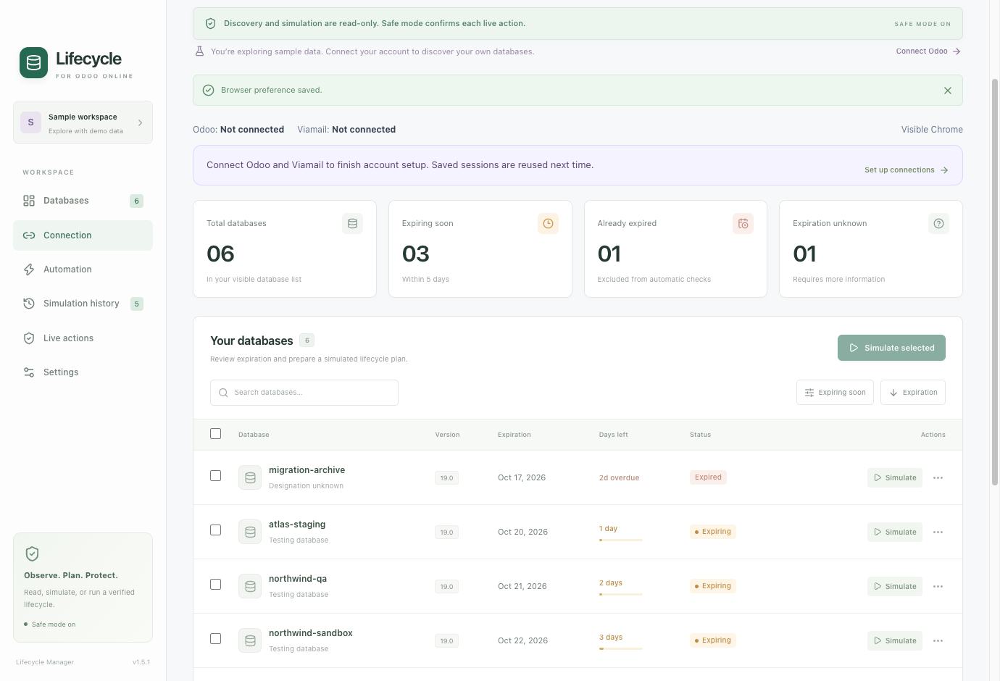

# Odoo Lifecycle Manager — macOS, V1.8.6

Open **Settings → How to use Lifecycle Manager** for a quick start and explanations of all six workspace sections, Safe mode, parent deletion, and activation.

A local Electron application for Odoo Online discovery, expiration monitoring, simulations, and database lifecycle execution.

**Safe mode is on by default.** It asks before duplication, sending activation email, activating a copy and parent deletion. Read-only checks run automatically. Turning it off requires a native confirmation, after which an explicit **Run lifecycle** or an enabled expiry rule creates, activates and verifies the copy, then retains both databases unless **Delete original after successful activation** is enabled in Automation. When enabled, deletion proceeds without per-action prompts. Automatic lifecycle rules are off by default. Simulation and discovery stay read-only. There is no production-copy option, rename/hide action, API-key input or environment-variable bypass.

Accounting databases are included in discovery, expiry reads, simulations, monitoring and live actions, with the same identity, access, activation and expiry checks as other databases. The previous name-based exclusion has been removed.

**Manage-page reader:** after manual sign-in in normal Chrome, the app discovers the account's visible databases and reads each non-excluded database's Manage information page. It accepts either the exact expiration displayed by Odoo or its days-remaining banner. An observed countdown keeps its read time and is never converted into an invented expiration date. See the [live verification record](docs/SAFETY-VERIFICATION.md).

## Download and install

Download the **universal DMG** from [GitHub Releases](https://github.com/condorsteel13-oss/odoo-lifecycle-manager/releases/latest). One installer supports both Apple Silicon and Intel Macs running **macOS 13 Ventura or later**.

1. Install [Google Chrome](https://www.google.com/chrome/) in `/Applications` if it is not already installed.
2. Open the DMG and drag **Odoo Lifecycle Manager** into **Applications**.
3. Open the app from Applications. This release is **not Developer ID signed or notarized**. macOS may block its first launch. If you choose to trust this release, use the app-specific **System Settings → Privacy & Security → Open Anyway** option after attempting to open it. Follow [Apple's instructions](https://support.apple.com/102445); do not disable Gatekeeper globally.
4. Connect your own Odoo and Viamail accounts. No account sessions, credentials or customer databases are included in the download. Node.js and developer tools are not needed to run the installed app.

Automatic email activation currently supports **Viamail at mail.viamtl.com**. Other email providers are not integrated. Odoo sign-in may require manual 2FA or a browser challenge. Backend permissions and Odoo's current interfaces still determine which operations work for each account. Testing copies have external actions neutralized; they are not production replacements.

Safe mode is on and automatic rules are off on a fresh installation. This is an independent utility, not an official Odoo product.

For each release, `SHA256SUMS.txt` contains the installer and ZIP checksums. Verify a downloaded file using `shasum -a 256 <filename>` and compare it with the published checksum. The ZIP is an alternative distribution of the same app.

## App updates (1.8.4 and later)

Install 1.8.4 once using its DMG. Versions 1.8.0–1.8.3 can download updates but cannot extract the replacement app inside Electron; 1.8.4 fixes this and supports subsequent in-app installations. Versions before 1.8.0 do not contain the updater. Keep the app in `/Applications/Odoo Lifecycle Manager.app` or `~/Applications/Odoo Lifecycle Manager.app`, in a folder your user can write to. Running from a DMG, a build folder, or a read-only Applications folder allows downloads but blocks installation.

In **Settings → App updates**, **Automatically check and download updates** is on by default. The app checks the latest stable GitHub release 15 seconds after startup and every six hours while open. Turn this off for manual **Check for updates** and **Download update** controls. Downloaded updates show **Restart to install**. The app never installs on ordinary quit and never restarts automatically.

Installation is blocked while any operation or lifecycle is active, including email delays, native confirmation dialogs and pending database reviews. The main process checks again after extracting the download and takes an exclusive lock before closing idle browser connections. Scheduled work and new actions cannot start while that lock is held. A separate installer waits for the app process to exit naturally; it never kills the app. It replaces only the app bundle, retains `.Odoo Lifecycle Manager.previous.app` next to it, and restores that backup if replacement or launch fails. Settings, encrypted sessions, reports and action records stay in Application Support.

Update extraction and cleanup use Electron’s native `original-fs` API so the replacement `app.asar` is handled as a physical file. The app’s ordinary ASAR support stays enabled. Local installation failures report the step that failed instead of suggesting an internet problem.

Updates use the public GitHub API for this exact repository, with no account credentials. The updater accepts only a newer stable version's exact universal ZIP, verifies its size and GitHub-generated SHA-256 digest, restricts HTTPS download redirects, rejects unsafe archive paths and symlinks, and validates bundle identity and version. This verifies download integrity relative to GitHub; it is **not** an Apple signature or notarization. The updater does not remove quarantine or disable Gatekeeper. macOS may still require app-specific approval for an unsigned release.

Before publishing, run `npm run check:update-package`. This validates the real ZIP in both Node and an isolated Electron process, including physical `app.asar` extraction and cleanup; it loads no account sessions.

To publish an update, build the universal DMG and ZIP, upload both plus `SHA256SUMS.txt` to a stable `vX.Y.Z` release in this repository, and publish it. The ZIP name must remain `Odoo-Lifecycle-Manager-X.Y.Z-universal.zip`; GitHub must report the completed asset's `sha256:` digest. Keep the bundle ID and executable name unchanged. Drafts, prereleases, downgrades and releases without a verifiable universal ZIP cannot install. No update server or Apple credentials are needed.

## Build from source

Requirements: macOS 13+, Xcode Command Line Tools (Swift), Node.js 22.12+ (Node 24 recommended), npm and installed Google Chrome for browser tests.

```sh
git clone https://github.com/condorsteel13-oss/odoo-lifecycle-manager.git
cd odoo-lifecycle-manager
npm ci
npm run dev
```

`npm run dev` starts Vite on `127.0.0.1:5173` and Electron. Restart after editing Electron code. To build and run locally:

```sh
npm run build
npm start
```

To create the universal Mac app, DMG and ZIP:

```sh
npm run package:mac
```

The build compiles the Chrome and update installer helpers for both CPU architectures and combines them. electron-builder produces `release/mac-universal/Odoo Lifecycle Manager.app` and universal DMG/ZIP artifacts in `release/`. The production bundle excludes development source maps, private local data and test browser downloads. This distribution and its update mechanism remain unsigned; no Apple Developer membership is required.

## Preview



## First use

1. On first launch, **Connection** asks you to connect both Odoo and Viamail. You can also explore **Databases** using the six sample scenarios. Search, filter, select several databases, and choose **Simulate selected**. Every report says **NO CHANGES MADE**.
2. Open **Connection → Connect to Odoo**. Installed Google Chrome opens the official login in a separate, app-owned profile. Complete sign-in and any 2FA/CAPTCHA manually. The app does not attach automation during this phase and never fills or logs credentials. Password saving is disabled in this profile. Your personal Chrome profile is not accessed. Existing app-owned sessions can be checked with **Check saved connections**.
3. Return to Lifecycle Manager and click **Read databases**. A guard closes the active login pages and switches to inert local documents. The reader retrieves the visible list, uses only the reviewed existing-user Odoo sign-in handoff when a database session is missing, validates the database session, and reads the Manage information page. The database applications and their management controls do not load. After a successful read, the session is saved in an encrypted, app-owned file using macOS secure storage. Chrome then uses the selected visibility mode. Choose **Connect to Viamail**, sign in manually, and click **Verify Viamail login**. Both connection statuses appear throughout the app. Background mode is the default; change it in Connection or Settings. Manual sign-in always stays visible.
4. In **Automation**, choose an expiry threshold, a 6/12/24-hour interval and all or selected databases. **Automatic monitoring** refreshes and simulates only. The separate **Run lifecycle automatically at the expiry threshold** checkbox opts into live lifecycle scheduling. Save the rule. Switching between sample data and Odoo disables both rules and clears the previous scope.
5. Use **History** to inspect reports or export JSON through the native save dialog. Use **Settings** for diagnostics and local session controls.

The app never opens individual database applications. Manual login runs in normal Chrome under your control. After handoff, a new or changed authentication route, additional interactive authentication, unexpected redirect, or challenge stops the affected read; it is not bypassed.

### Automatic Chrome recovery

Before opening either account connection, the app checks its dedicated Chrome profile for an abandoned browser from a previous crash or interrupted startup. It records the owning app process and its start time, then checks the Chrome executable, exact profile and local debugging port before closing an orphan. This also handles a launcher that exited before Chrome finished starting. Reconnecting then uses the existing saved session; recovery does not clear cookies or require a new login while that session remains valid.

Recovery applies only to Lifecycle Manager's two profiles. A live owning app, another active background launcher, an unrelated Chrome profile or uncertain ownership blocks cleanup and shows a connection error. Personal Chrome is left alone. The app requests a normal termination, waits for Chrome to exit and never force-kills it or deletes Chrome's singleton locks. Ownership metadata is stored alongside each app profile; no credentials are included. Recovery itself makes no Odoo database changes.

## Duplication and activation preferences

Open **Settings → Duplication & activation** and click **Save duplication settings** after editing:

- **Activation email delay (minutes)** defaults to **3**, with whole values from **0 to 60**. The wait starts when the app first confirms the new copy is available. If Odoo resends the activation message to the signed-in user, it starts from that confirmed send instead. The delay is saved with each new creation record and survives restarts; changing the setting affects future copies. Existing records without a saved delay use the current setting. Guided and automatic runs wait with a progress indicator, and **Stop lifecycle** remains available. The manual email button shows a countdown. A completed activation or saved redirect handoff does not require another mailbox wait.
- **Copy name template** defaults to **`{name}-copy-{date}`**. Use `{name}` exactly once for the original name and optionally `{date}` for the UTC date (`YYYYMMDD`), plus lowercase letters, numbers, and hyphens. For example, `{name}-copy` proposes `example-db-copy`. The original-name portion is shortened to keep names within 50 characters; existing names receive numeric suffixes such as `-2`. Manual proposals, simulations and new scheduled jobs use the template. Already queued names and existing records retain their names. The name can still be edited in Live actions before review.

Saving these preferences does not enable a lifecycle rule or start database actions. Existing Safe mode, identity and deletion gates continue to apply.

## Live action settings

In **Settings → Live actions**, or directly in **Live actions**, choose **Delete original database after successful activation**. This is the same saved option shown in Automation. Saving the choice starts no action and does not reset the rule schedule.

| Safe mode | Delete original | Result of Run lifecycle |
| --- | --- | --- |
| On | On | Confirm duplication, activation email sends, activation, then original deletion separately. |
| On | Off | Confirm duplication and activation steps; keep both databases. |
| Off | On | Create, activate and verify the copy, then delete the original without step prompts. |
| Off | Off | Create, activate and verify the copy; keep both databases. |

Deletion still requires a distinct, activated testing copy with verified positive expiry. Cancelling a confirmation stops before its request and prevents later steps. An unfinished cycle uses the current deletion choice when explicitly continued; completed cycles stay closed.

## Safe mode and lifecycle rules

1. Connect Odoo and Viamail once. Open **Settings → Safe mode**. Leave it on for separate approvals before creating a copy and before deleting its parent.
2. For a single cycle, open **Live actions**, choose the original and copy name, then **Run lifecycle**. With Safe mode on, type the original name, authorize a testing copy, and confirm the native creation dialog. The app waits for the copy and asks before sending activation email and activating it, verifies its identity and expiry, then retains both databases when deletion is off. If deletion is enabled, it presents a separate deletion review. That review retains the backup, integrity and subscription attestations and its own native confirmation.
3. With Safe mode off, **Run lifecycle** performs the same sequence without per-action confirmations, honoring the deletion setting. The app does not create a backup or claim business-data completeness. Identity, family, access, neutralization, activation, positive Manage expiry and permissions remain required. The copy may inherit its parent's expiry; extension is neither required nor promised.
4. For scheduled cycles, open **Automation**, tick **Run lifecycle automatically at the expiry threshold**, choose **All discovered databases** or **Specific databases**, set the threshold and interval, then save. This works independently of the simulation monitoring toggle. Safe mode on queues matches for approval in **Live actions → Lifecycle queue**; Safe mode off processes them sequentially. The first scheduled check occurs within approximately one minute of saving, then at the configured interval. Checks run only while the app is open and awake. **Run lifecycle rule now** runs the saved rule immediately.
5. Selected rules follow the verified replacement copy after its parent is deleted. To prevent an endless chain, a copy with inherited expiry does not trigger another automatic cycle for that same expiry. A later expiry event must be observed before it can be scheduled again. Countdown boundaries are approximated only for deduplication; the UI and deletion gate never treat them as exact dates.

The global **Stop lifecycle** button prevents the next action and the next database in a batch from starting. A request already submitted may complete. Verification polls every 15 seconds for up to 15 minutes, excluding the configured activation-email delay; if the copy or email is not ready, the record pauses for attention. **Continue lifecycle** explicitly resumes verification and activation without submitting duplication again. Continuing an unfinished cycle uses the current deletion setting. With Safe mode on, each live step still requires confirmation; with it off, deletion proceeds only when enabled and the copy passes verification.

**Test automation without deletion:** open **Automation**, leave **Delete original after successful activation** unchecked, then **Save monitoring rule**. This option defaults to off, including when upgrading an older state file. It applies to automatic rules and **Run lifecycle**, independently of Safe mode. A successful run activates the copy, verifies its identity and expiry, and closes the cycle with both databases retained. No deletion review or deletion request is issued. An unfinished cycle uses the current deletion setting when explicitly continued. Completed cycles stay closed. Turning it off invalidates pending reviews. The selected scope stays with the original when it is retained, and completed expiry events do not repeatedly duplicate it.

The progress bar reports lifecycle milestones, not estimated time: duplication, confirmed copy creation, waiting for email, email received, activation, expiry verification, optional deletion, and completion with both databases retained. The original and copy names identify each step. Success milestones are shown only after confirmation; a duplication acknowledgment alone does not claim the copy is created. The current message remains after completion, and **Live actions → Live action log → Step history** preserves the transitions across restarts. Failed steps show **unsuccessful**; stopped runs show **interrupted**. A timeout after a submitted mutation shows **outcome uncertain**, since the server may have completed it. Uncertain requests are never replayed automatically. Waiting for the user’s deletion confirmation is a separate state.

All mutation intents are recorded before submission. Requests are never blindly retried. Uncertain creation is reconciled through reads; uncertain or partially completed deletion stays locked for manual inspection in Odoo. An interrupted scheduled run becomes **attention** on restart and cannot resume automatically. Enabled rules may check other pending or newly due databases on schedule. Failed jobs require an explicit continuation. Dismissing a queue item suppresses that expiration event. Keep the local action log and queue: they preserve identity and deduplication evidence.

Each Safe mode review is single-use and expires after five minutes; native dialogs default to Cancel. **Review duplication** remains available in Safe mode for creating a copy only, with manual **Activate copy**, **Read activation email**, **Verify copy** and **Review deletion of original** controls.

If you manually removed a previously identified copy, choose **I removed this copy — close cycle**. This local operation verifies the original UUID and checks absence by copy name and UUID from the visible list; it preserves the removal assertion and history. List absence is not independent proof of deletion. Uncertain creation/deletion outcomes cannot be closed this way. Historical copy names stay reserved and absent copies are checked again before new creation. Closed records cannot activate a copy or authorize parent deletion.

## Validation and coverage

The live account list has been read successfully by the app. Automated tests also validate strict metadata projection, redirects, database authentication boundaries, and the Electron interface with isolated sample data. See the verification record for exact test counts and live expiration results.

Coverage means the account's visible list returned with `share: false`, including its child databases. Hidden databases and databases to which the account lacks access are outside coverage. Identity mismatches or an unsupported list response reject the whole new snapshot. An individual unavailable date remains Unknown with an explanatory discovery note.

## Expiration semantics and Odoo restrictions

- Manage-page countdowns are displayed with the time they were read, including zero or negative values. They are stored as observations, not rolling predictions. Simulation-only monitoring requires exact dates; live lifecycle rules also accept fresh Manage countdowns. Manual simulation reports retain the observed count.
- Explicit ISO dates and English month-name dates with a year are accepted. Ambiguous numeric dates, relative text, conflicting dates, and arbitrary UI timestamps without a timezone remain Unknown. Exact dates and timestamps are shown in database details. Billing dates are never substituted for expiration.
- A date with no time uses this Mac’s calendar day; “today” is 0 days remaining. Exact timestamps use elapsed 24-hour periods, rounded up; a past timestamp is expired even if it is less than a day old.
- Automatic rules include known expirations from today through the threshold. Already-expired and suspended databases and missing dates are excluded. An unavailable duplication control can match the expiration rule, but its report explicitly marks eligibility blocked.
- Automatic history is deduplicated by source, stable database identity, and observed expiration. Manual simulations remain repeatable. A changed expiry produces a new event. There is no automatic history truncation that would erase deduplication evidence.
- Odoo documents a 15-day duplicate lifetime and a five-copy limit per source. It does **not** establish that deleting an original resets a copy’s expiry or releases quota. Duplicate-of-duplicate and trial-specific permissions require account-specific verification. Current and older deletion/subscription documentation differ.

See [the research notes](docs/ODOO-RESEARCH.md) for all ten requested questions, official sources, and unresolved restrictions. This application does not claim that a copy/delete renewal loop is supported.

## Safety architecture

- `src/domain/simulation.ts` is a pure local report generator with no Electron, filesystem, browser, or network dependency. It cannot execute its proposed steps.
- `electron/chrome-login.ts` launches installed Chrome with a dedicated profile and a loopback-only debugging port. It does not set automation or stealth flags. Playwright attaches to manual sign-in only after the user hands it back. Subsequent Odoo reads use normal Chrome launched hidden by macOS, a guarded bootstrap, and hidden reader targets; Viamail uses headless Chrome.
- `electron/reader.ts` permits one exact request at a time from app-owned inert documents. List parameters are fixed to `{share:false}`; session-information parameters are empty. The Manage token request `/saas_worker/db/info/json` has the fixed body `{}`; `/my/database` is retrieved with only the returned token and `lang=en_US`. A database origin must match a validated listed database. No arbitrary URL, body, selector, or script API is exposed.
- Metadata fetches use `redirect: 'error'`. The narrowly scoped authentication handoff uses `redirect: 'manual'`; each permitted step is checked separately, and the final application redirect is never followed. The observed Manage flow uses the exact `/saas_trial/trial-connect` sign-in form with validated database UUID, token and final Manage destination. The final application navigation is never sent. The optional `/auth_oauth/oea` handoff permits only the reviewed existing-user controller. General OAuth signup is unsupported. Mutation routes are permitted only by the fixed live adapters described below.
- `electron/live-service.ts` validates fresh identity/subscription information and durable intent logs in both modes. Safe mode adds single-use five-minute reviews, typed names, backup/integrity/subscription attestations and native confirmation. The main-process lifecycle runner alone can consume an automatic review, and only while Safe mode is off and that run has not been stopped. No IPC exposes that internal commit method. `electron/live-contract.ts` projects a strict administrator Manage contract; credentials exist only in main-process memory.
- Duplication and deletion use Odoo’s observed `/saas_worker/dup/json` (testing=true, support=false), `/my/databases/delete`, and `/saas_worker/drop/json`. Deletion stops if the first step is not confirmed. Activation uses the fixed email and identity-bound redirect adapters described below. `/odoo-enterprise/trial-check` is a fixed read-only name check. No arbitrary URL/method/body is accepted from IPC.
- All other requests and WebSockets are blocked. Service workers are stopped and bypassed for reader requests. Remote scripts, forms, and application HTML never run in the reader. A safety violation rejects the new snapshot.
- `electron/policy.ts`, `guard.ts`, and the HTML fixture adapter retain regression coverage for the earlier protected-browser implementation. They are not the production login or discovery transport in 1.1.
- The Electron renderer is sandboxed, with Node integration disabled, context isolation enabled, a CSP, navigation/window restrictions, and a fixed IPC API that validates its sender and settings. No renderer APIs expose filesystem paths for reading or arbitrary browser execution.
- The current Manage page embeds an `openerp_enterprise.MyDatabaseInfo` component. Its JSON props are parsed in memory without running scripts. The reader validates database name, UUID and origin, then projects only the fields the official template displays: trial `expireIn`, conditional subscription `days_valid`, and `until_str`. Read-only metadata discards tokens and billing/contact data. Live preflight retains only its required auth fields transiently in the main process, never in renderer state or logs. Rendered banner HTML also has a fixture-tested parser.
- Ordinary app state contains only metadata, preferences, action phases, fixed restriction categories and the user’s backup/integrity attestations. Separately, provider-scoped authentication sessions are stored in encrypted vault files using Electron safeStorage backed by macOS Keychain. Raw HTML, request bodies, screenshots, traces, console messages from authenticated pages, cookies, and tokens are not saved to logs or reports.
- Report export explicitly projects report fields; it does not export application state or the browser profile.

Authentication necessarily creates a session and may update Odoo’s authentication bookkeeping. The discovery/simulation boundary prevents lifecycle/business mutations; the separate live workflow permits only requests authorized by Safe mode confirmations or an explicitly enabled automatic workflow; it is not a claim that a remote login is a transaction with zero authentication-side writes. Odoo itself controls any expiry or retention process independently of this app.

## Local storage and diagnostics

The exact locations are displayed in Settings. Electron normally places them beneath:

```text
~/Library/Application Support/Odoo Lifecycle Manager/
  data/state.json                 settings, latest snapshot, simulation history, live action log
  chrome-profile/                 dedicated Chrome session and local browser storage
  updates/                        update preferences, verified downloads and installer results
```

The JSON file is written with file/directory sync and atomic rename, with owner-only permissions; its containing directory and browser profile are owner-only. Keep the browser profile private: persistent cookies are sensitive even though no password is saved by app code. Reports contain database names and proposed names, which may also be confidential business metadata.

Invalid state files are preserved as `state.corrupt-<timestamp>.json`; the app loads safe defaults, disables monitoring, and persistently locks live actions pending recovery of the action log. Disk-write errors do not silently discard the existing saved state. Diagnostics are sanitized and kept in memory for the current run. Clearing saved sessions closes both app-owned browsers, deletes both profiles and encrypted vault files, and disables monitoring; history and cached metadata remain. Cached simulations explicitly note when authentication is not confirmed.

Monitoring runs on a one-minute scheduler tick while the app is open, using a 6/12/24-hour check interval. Attempts are recorded before network work, so failures respect the interval. Only one operation runs at a time. Sleeping or closing the app pauses checks; there are no agents, daemons, or catch-up bursts.

## Tests

```sh
npm run browser:install  # offline fixtures only
npm run typecheck
npm test
npm run build
npm run test:integration
# Or all of the above:
npm run check
```

Unit tests cover 1/3/30-day, expired and unknown dates, unavailable duplication/deletion, subscription-linked production data, multiple databases, quota limits, expired sessions, interface changes, naming conflicts, exports, local persistence, and fixed read-only monitoring settings and live confirmation gates. Browser tests assert that unapproved mutation methods, mutation GETs/queries, redirects, unknown RPC, and WebSockets cannot reach the local fixture server. Separate local-only tests verify the exact approved live request bodies and partial failures. They also check inert manager HTML and normal mock-login cookie continuity.

Desktop integration tests exercise all six screens, multi-selection, manual/automatic reports, deduplication, native-save export, and restart persistence. They use a temporary data directory and never connect to an actual Odoo account. `LIFECYCLE_TEST_DATA` can isolate local data only in unpackaged builds; it cannot change network policy or enable execution.

Legacy public-only guarded-browser smoke test (not the production 1.1 login):

```sh
npm run check:public-login
```

This is deliberately separate from the offline test suite. CAPTCHA or access restrictions must be completed by the user, not bypassed. The source project’s browser tests need permission to launch GUI processes and bind localhost.

## Project layout

```text
electron/          app lifecycle, restricted IPC, browser guard, extractor, atomic JSON store
src/domain/        expiration math, rules, simulations, export projection, demo fixtures
src/shared/        typed desktop contract
src/App.tsx        six-screen React dashboard
scripts/           development, build, icon and public-login utilities
tests/             unit tests, manager fixtures, local-network and desktop tests
docs/              official Odoo research and verification record
```

The existing sibling `odoo-playwright` Contacts/Helpdesk proof of concept is independent and was not modified. No credentials, profiles, environment files, or code from that project are reused.


## Email activation after duplication

In **Live actions**, choose **Activate copy** on the existing creation record. The app freshly reads Odoo’s activation status, the signed-in database user’s `user_email`, and the activation message’s `activation_email`. It requests an activation email for the signed-in user only when Odoo reports a different or missing recipient. No address is hard-coded. A durable per-copy send record prevents repeated emails after timeouts or restarts. A user change during the active handoff stops the operation.

Connect the matching Viamail mailbox once on the Connection screen, then choose **Read activation email**. The saved connection follows the selected background/visible mode. The current mailbox adapter supports the supplied `mail.viamtl.com` SmarterMail host. It verifies the mailbox identity, searches the Inbox for the tracked copy, and reads only a recent Odoo activation message addressed to that user. Mailbox session credentials are used only in the main process and restricted browser reader, and stored only in the encrypted session vault and browser-owned profile. Email bodies and activation links are never logged or persisted. It does not load remote images, open attachments, send mail/read receipts, delete messages, or mark them read. Unknown activation-link formats stop for review.

Activation follows Odoo’s validated redirect to the exact copy’s `/saas_worker/signin`, then reads the identity-bound `/odoo-enterprise/invite-users` completion page without running scripts or sending invitations. Each request uses manual redirect handling. Pending signed redirects are stored separately in macOS-encrypted checkpoints, never in logs, reports or renderer state. **Complete activation** resumes a saved, unsubmitted handoff or rechecks the completion page; it does not replay an activation request with an uncertain outcome. Closing the app preserves these checkpoints. Clearing saved sessions removes them.

**Verify copy** remains read-only and requires completed activation and positive time remaining from a fresh Manage read. An incomplete activation handoff or zero-day copy cannot unlock deletion. Odoo lineage can be the immediate source or its shared root; the source and copy UUIDs must differ. Activation never deletes the original. For a copy-only test, **Keep both databases — close cycle** verifies the original and copy, closes the local action record and prevents that record from continuing into deletion.

## Saved connections and browser visibility (V1.4.1)

Both cards start disconnected until a server check succeeds; the existence of a saved profile is never treated as proof of login. Successful connections are checked at startup and periodically while the app runs. Odoo checks read only the account list; Viamail checks read only user-mail settings and discard the response. Connection restoration and visibility changes do not perform lifecycle work. Separately enabled lifecycle rules can check and run due work on their saved schedule, including after startup. Interrupted cycles are not replayed. Discovery includes accounting databases under the same read-only rules.

The session vault stores only Odoo-domain cookies or the selected Viamail identity and access/refresh tokens. It is encrypted with macOS secure storage, owner-readable only, excluded from reports and renderer state, and fails closed if secure storage is unavailable. Native browser storage also remains in the app-owned profiles. A legacy Viamail profile can be upgraded only when it contains one unambiguous, non-impersonated account. The app never reads personal Chrome profiles or stores passwords. Server-side expiry, revocation, 2FA or Cloudflare challenges may still require visible manual sign-in; background mode does not bypass them.

**Close both browsers** retains the saved sessions but pauses automatic reconnection and monitoring. **Check saved connections** reconnects them. **Clear both saved sessions** removes only the two app-owned profiles, including their encrypted vaults; metadata and action history remain. Switching visibility preserves saved sessions and invalidates any pending live review, without submitting a lifecycle action.

In v1.4, Odoo returned HTTP 403 in Chromium headless mode even though the same saved session worked in normal Chrome. In v1.4.1, **Background — no Chrome windows** uses normal Chrome launched hidden through macOS Launch Services, with `--no-startup-window`. The launcher confirms the owned instance is hidden before creating a blank bootstrap window; it is replaced immediately by a guarded, windowless anchor and hidden reader targets. The anchor prevents Chrome’s empty-target startup failure and remains inert until the app closes. It preserves the browser’s native identity without user-agent overrides or challenge handling. The existing request guard runs on every hidden reader, and a compatibility failure stops instead of opening a visible window. The stored `headless` preference remains compatible with earlier versions; its Odoo implementation now uses windowless normal Chrome. Viamail continues to use headless mode.


Live verification on 19 October 2026: both saved connections succeeded in Background mode, including after restarting the packaged app. All seven non-accounting databases returned fresh Manage expiry evidence. The app-owned Chrome instance was confirmed hidden with zero browser windows. Accounting was excluded, monitoring remained off, and no lifecycle actions ran.
